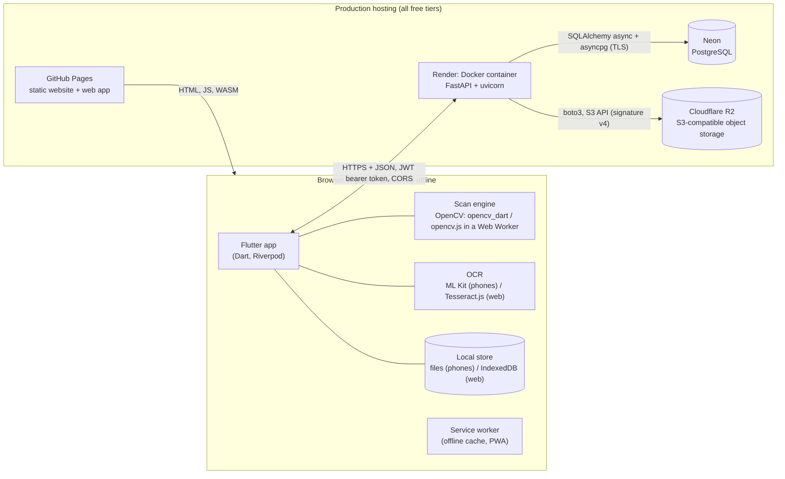
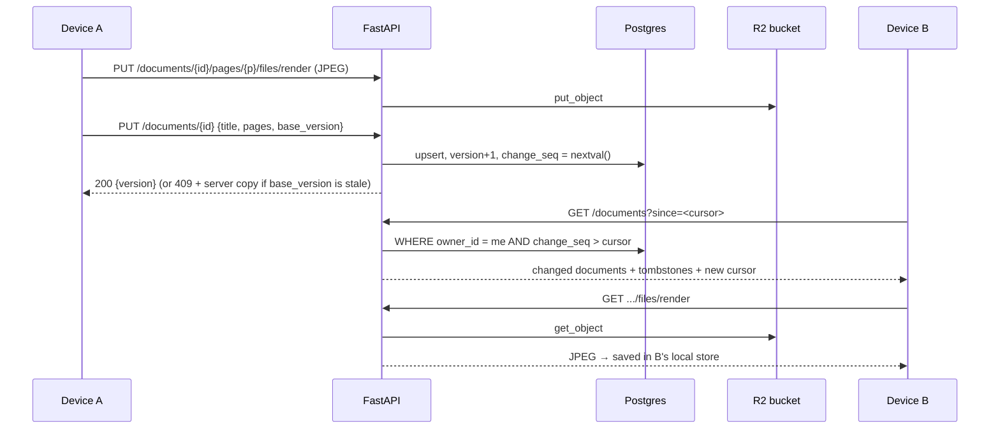
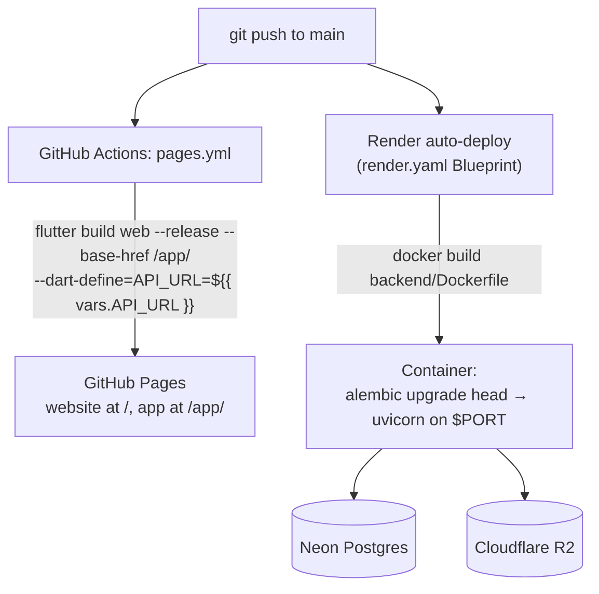

# How DocScanner works (technical overview)

This page explains the whole system end to end: what runs where, how a scan becomes
a PDF, how accounts and sync work, and how it is deployed. For *why* each choice was
made (and what was considered instead), see [`TECH_DECISIONS.md`](TECH_DECISIONS.md).

**Live:**

| | URL |
|---|---|
| Website | https://manav252.github.io/DocScanner/ |
| Web app | https://manav252.github.io/DocScanner/app/ |
| Backend API | https://docscanner-api-vwgz.onrender.com ([`/health`](https://docscanner-api-vwgz.onrender.com/health), [`/docs`](https://docscanner-api-vwgz.onrender.com/docs)) |

---

## 1. The big picture



The design is **offline-first** and **local-first**:

- Scanning, editing, markup, OCR and PDF export all run **on the device**.
- The backend is **optional**. It is used only for accounts, backup and syncing between devices.
- Scans never leave the device unless the user signs in **and** chooses to back them up.

| Layer | Technology | Role |
|---|---|---|
| UI / app | **Flutter 3.47** (Dart 3.13) | One codebase compiled to Android, iOS and the web |
| State management | **Riverpod 3** (`Notifier`, `FutureProvider`, `select`) | Reactive state, dependency injection, testable logic |
| Computer vision | **OpenCV**: `opencv_dart` (native FFI) / `opencv.js` (WebAssembly) | Page detection, perspective warp, filters |
| Text recognition | **Google ML Kit** (phones), **Tesseract.js** (web) | On-device OCR, English and Hindi |
| Local persistence | Key-value store: files (phones), **IndexedDB** (web) | Documents (JSON) and page images (JPEG) |
| Backend | **FastAPI** (Python 3.12), **uvicorn** (ASGI server) | REST API: auth, documents, sync, server-side detection |
| ORM / migrations | **SQLAlchemy 2 (async)** + **asyncpg**, **Alembic** | Database access and schema versioning |
| Database | **PostgreSQL** (Neon in production; Docker locally) | Users, document metadata, sync counters |
| Object storage | **S3 API** via **boto3** (Cloudflare R2 in production, MinIO locally) | Page images |
| Auth | **Argon2id** password hashing, **JWT** (HS256) access and refresh tokens | Stateless authentication |
| Hosting | **GitHub Pages** + **GitHub Actions**, **Render** (Docker), **Neon**, **R2** | Free production deployment |

---

## 2. Repository map

```
app/                 Flutter app
  lib/features/      Screens: home, capture (scanner), corners, editor, markup, library, settings, account
  lib/imaging/       Scan engine interface + native (opencv_dart) and web (opencv.js worker) implementations
  lib/data/          Models, DocumentRepository, KeyValueStore, page renderer, thumbnails, backup ZIP, sync/
  lib/services/      Camera, API client, OCR, import, export
  web/               index.html, service worker (sw.js), opencv.js, Tesseract.js + language data, pdf.js
  tool/strings.py    Single source of all UI strings (English + Hindi) → generated l10n
backend/             FastAPI service, Alembic migrations, Dockerfile, tests
  app/api/           auth.py, documents.py (sync protocol), process.py (server-side detection)
  app/core/          config.py (env-var settings), security.py (hashing, JWT)
  app/services/      storage.py (S3), imaging.py
scanner_core/        Python reference implementation of the detector
shared/              Detector parameters + test photos shared by all three detectors
website/             Showcase site (served at the root of GitHub Pages)
render.yaml          Render "Blueprint": infrastructure-as-code for the API service
.github/workflows/   pages.yml: builds and deploys website + web app
```

---

## 3. From camera to PDF (on the device)

### 3.1 Capture and page detection

1. **Camera stream.** The `camera` plugin is used on phones and `getUserMedia` in the browser. Frames are downscaled and sent to the scan engine.
2. **Off the UI thread.** Detection never blocks the UI:
   - on phones it runs on a long-lived background **isolate** (Dart's thread equivalent);
   - on the web it runs in a **Web Worker** running opencv.js (WebAssembly).
3. **Detection pipeline** (classic computer vision, no ML model):
   1. Convert to **grayscale** at 500 px.
   2. Apply a **Gaussian blur**.
   3. Run **Canny edge detection** with adaptive thresholds (from the median brightness), then **dilate**.
   4. Find **contours**, simplify them with **`approxPolyDP`**, and keep convex quadrilaterals that pass area and angle checks. A **CLAHE** fallback pass handles low-contrast pages.
   5. Refine each edge with a **Huber-loss line fit** on gradient samples, then intersect neighbouring lines to get **sub-pixel corners**.
4. **Live guidance.** Corners are **smoothed** across frames. Steadiness and brightness are checked, and the user sees an outline plus hints ("Move closer", "Hold still"). Once the page is steady, the app **auto-captures**.
5. **Normalisation.** The full-resolution photo is made upright using its **EXIF** orientation, capped at 4000 px, and detected again.

### 3.2 Correction and rendering

- **Corner review.** The user can drag corners or edges, use a loupe, or choose "Use full photo".
- **Perspective transform.** `getPerspectiveTransform` + `warpPerspective` (bicubic) map the four corners to a flat rectangle. This step is often called *homography* or *keystone correction*.
- **Filters:**
  - *Magic Color* divides by an estimated paper background, which removes shadows, then stretches contrast.
  - *Black & White* uses **adaptive thresholding**.
  - *Grayscale* and *Original* are also available.
- **Outputs saved for each page:**

  | File | Purpose |
  |---|---|
  | `source.jpg` | original photo |
  | `flat.jpg` | warped page, at most 2480 px (A4 at 300 dpi) |
  | `render.jpg` | filtered page, JPEG quality 85 |
  | `thumb.jpg` | small cached thumbnail for fast lists |

  Edits are **non-destructive**: corners, filter, rotation and crop are stored as parameters, and the page is re-rendered from the source photo.

### 3.3 Markup, OCR and export

- **Markup** (text, pen, highlighter, signature, shapes, whiteout) is stored as **vector items**, so it stays editable. It is **burned in** (rasterised) only at export.
- **OCR** runs in the background:
  - **ML Kit** on phones, **Tesseract.js** on the web, with Latin and Devanagari scripts.
  - Words below 50 % confidence are dropped, which keeps photos without text from producing noise.
- **PDF export** uses the Dart `pdf` package on the device:
  - Each page image is placed on a PDF page, with an **invisible text layer** (render mode 3) on top. The PDF is therefore **searchable and copyable**.
  - Noto Sans Devanagari is embedded for Hindi.
- **Long tasks** (export, import, OCR, ZIP backup) report progress and can be cancelled through a `CancelToken`.

### 3.4 Local storage

Everything goes through one small interface, `KeyValueStore` (`get`, `put`, `delete`):

- **Phones:** files in the app's documents directory.
- **Web:** **IndexedDB**, which persists across reloads and works offline.
- **Tests:** an in-memory store.

Keys:
- `doc/<id>.json` holds the document **JSON**: title, pages, corners, filters, markup, OCR text, and the sync fields from section 5.3.
- `page/<pageId>/source.jpg`, `render.jpg`, `thumb.jpg` and `ocr.json` hold the page files.

`DocumentRepository` sits on top of the store.

**Backup without an account:** Settings › *Export all documents* writes a **ZIP**: a manifest, one JSON file per document, and the page files. *Import backup* restores it, and a newer copy replaces an older one.

### 3.5 Web app as a PWA

- The web build is a **Progressive Web App**: it has a manifest and can be installed.
- `sw.js` is a **service worker**. After the first visit it **pre-caches** the app shell, opencv.js, Tesseract.js and the language data, so the app opens and works **offline**.
- The worker is registered a few seconds after load, once the app is idle, so it doesn't slow down the first paint.

---

## 4. The backend (FastAPI)

### 4.1 Endpoints

| Method + path | Purpose |
|---|---|
| `POST /auth/register` | Create an account. The password is hashed with **Argon2id**. |
| `POST /auth/login` | Check the password and return an **access token** (60 min) and a **refresh token** (30 days) |
| `POST /auth/refresh` | Exchange a refresh token for a new access token |
| `GET /auth/me` | The current user |
| `GET /documents?since=<cursor>` | List documents, or only the changes since a cursor (for sync) |
| `PUT /documents/{id}` | Create or update document metadata (with `base_version`) |
| `DELETE /documents/{id}?base_version=N` | Delete; leaves a **tombstone** |
| `PUT/GET /documents/{id}/pages/{page_id}/files/{kind}` | Upload or download a page image |
| `POST /documents/upload` | Create a document from uploaded PDFs/photos (every PDF page becomes a page; photos get detection + Magic Color on the server) |
| `GET /documents/{id}/pdf` | Server-built PDF of a document |
| `POST /process` | Server-side page detection (same algorithm, Python `scanner_core`) |
| `GET /health` | `{"status","database","storage"}`: checks Postgres **and** the bucket |

Interactive API docs (**OpenAPI / Swagger UI**) are generated automatically at `/docs`.

### 4.2 Authentication and security

- **Password hashing:** passwords are hashed with **Argon2id** (via `pwdlib`), a memory-hard algorithm, and never stored in plain text.
- **JWT access tokens:**
  - signed with **HS256** using `DOCSCANNER_JWT_SECRET`;
  - claims: `sub` (user id), `type`, `iat`, `exp`, `jti`;
  - sent as `Authorization: Bearer <token>`.
  - The API is **stateless**: no server-side sessions.
- **Token refresh:** on a **401** response, the app's API client uses the refresh token once, then retries the request.
- **Data isolation:** every document query is filtered by `owner_id`, so users only ever see their own documents.
- **CORS:** browsers may call the API only from `https://manav252.github.io`.
- **Request limits:** request size and page count are limited (20 MB per upload, at most 500 pages per document), and uploaded file types are checked from their content.
- **Secrets:** none in the repository. The database URL, S3 keys and JWT secret are **environment variables** set in Render. `backend/.env.example` lists the variable names only.

### 4.3 Data model

- **PostgreSQL** holds the metadata:
  - `users(id, email, password_hash, created_at)`
  - `documents(id, owner_id, client_id, title, created_at, updated_at, version, change_seq, deleted, pages JSONB)`
  - `client_id` is the document's id from the app; it is unique per owner and stable across devices.
  - `pages` is **JSONB**: the page list with its edit parameters, markup and OCR text.
- **Object storage** holds the images, as `doc_prefix/<page>/<kind>.jpg` keys in the bucket. Keeping large binaries out of the database keeps Postgres small and fast.
- **Alembic** migrations version the schema. They run automatically each time the container starts (`alembic upgrade head`).

---

## 5. Backup and sync between devices

### 5.1 Protocol

Documents sync only after sign-in, and only those the user marked for backup.



### 5.2 Key mechanisms

- **Change cursor.** A global PostgreSQL **sequence** (`change_seq`) is stamped on every write. A client asks for "everything after N" and stores the new cursor. This is **incremental sync**: no full re-download, no reliance on device clocks.
- **Optimistic concurrency.** Each document has a `version`. An update must send the `base_version` it was based on. If someone else changed the document in the meantime, the server answers **409 Conflict** with its copy. The app then keeps the **newer edit** (by `updatedAt`, last-writer-wins) and tells the user which documents were affected.
- **Tombstones.** A delete marks the row `deleted` instead of removing it, so other devices learn about the delete when they pull.
- **Files before metadata.** Images are uploaded before the document that references them, so a document never points at missing files.

### 5.3 Sync fields on the device

| Field | Meaning |
|---|---|
| `revision` | Increased on every local edit |
| `syncedRevision` | The last revision uploaded. `revision > syncedRevision` means the document needs syncing. |
| `remoteId` / `serverVersion` | The document's identity and version on the server |
| `backup` | Whether the user chose to back this document up |

`SyncController` (a Riverpod `Notifier`) runs the sync and shows its phase on screen (`signedOut`, `idle`, `waking`, `syncing`, `offline`, `error`).

---

## 6. Deployment (production)



- **Frontend (GitHub Pages).** The `Deploy website and web app` workflow:
  1. installs Flutter;
  2. builds the web app with **`--dart-define=API_URL=…`**: a **build-time constant**, read in Dart with `String.fromEnvironment`, so no config file or secret ships with the app;
  3. runs `tools/pwa_precache.py` to write the service-worker cache list;
  4. publishes the website at `/` and the app at `/app/`.

  The API address comes from the repository variable **`API_URL`**, currently `https://docscanner-api-vwgz.onrender.com`.
- **Backend (Render).** `render.yaml` is a **Blueprint** (infrastructure as code) for a free Docker web service.
  - It builds `backend/Dockerfile`.
  - The container runs migrations, then starts **uvicorn** on Render's **`$PORT`**, with `--proxy-headers` because Render terminates TLS in front of it.
  - Render polls **`/health`** before sending traffic, which gives zero-downtime deploys.
- **Configuration** is read from environment variables by **pydantic-settings**:

  | Variable | Value |
  |---|---|
  | `DATABASE_URL` | Neon's connection string. The app converts it to the `postgresql+asyncpg://` driver form and maps `sslmode=require` to asyncpg's `ssl=require`. The **direct** (non-pooled) connection is used, because PgBouncer transaction pooling breaks asyncpg prepared statements. |
  | `DOCSCANNER_S3_ENDPOINT`, `…_ACCESS_KEY`, `…_SECRET_KEY` | Cloudflare R2, region `auto`, bucket `docscanner`. The token is scoped to that bucket only, so the health check falls back from `HeadBucket` to `ListObjectsV2`. |
  | `DOCSCANNER_JWT_SECRET` | Generated by Render |
  | `DOCSCANNER_CORS_ORIGINS` | `["https://manav252.github.io"]` |

### 6.1 Cold starts (free tier)

Render's free plan **sleeps** the service after 15 minutes without traffic, and the first request then takes up to about a minute while the container boots. The app handles this with `ServerWaker` (`app/lib/data/sync/server_waker.dart`):

1. When the app opens, it pings `/health` in the background (a *warm-up*), so the server is usually awake before anyone signs in.
2. If the server doesn't answer, it **retries every 4 s for up to 90 s**. Meanwhile it shows *"Waking up the server, this can take up to a minute…"* with a spinner.
3. Sign-in and sync **wait** for the server instead of failing. If the server went back to sleep in the middle of a session, the app wakes it again once.

An uptime monitor that pings `/health` every 10 minutes keeps the server awake (see [`DEPLOY.md`](DEPLOY.md)).

---

## 7. One request, start to finish

*"I scan a page on my laptop and it appears on my phone."*

1. The laptop browser detects the page (opencv.js in a Web Worker), warps it, renders a JPEG and stores it in **IndexedDB**. The document's `revision` goes up.
2. `SyncController` sees `revision > syncedRevision` and checks that the server is awake (`/health`).
3. Over **HTTPS** with the **JWT**, the app uploads the page JPEGs (`PUT …/files/render`). FastAPI checks the token's signature, streams each file to **R2** and writes the metadata to **Neon** (`PUT /documents/{id}`, `version + 1`, new `change_seq`).
4. The phone signs in. Its first pull is `GET /documents?since=0`. It receives the document, downloads the images, saves both locally and stores the new cursor.
5. The phone now has a full **offline copy**. It can open the document, run OCR and export a searchable PDF without the network.

---

## 8. Quality and testing

- **Tests:** 344 automated tests across Dart/Flutter, Node, the Python detector and the backend API. The backend tests run against real Postgres and MinIO. See [`TESTING.md`](TESTING.md).
- **Cross-checks:** the three detector implementations are tested against the same photos and expected corners.
- **Accessibility:** WCAG 2.2 AA checks with **axe-core** and **Lighthouse**, plus full flows scripted in Chrome.
- **Performance:** load, delete, scroll and memory were measured before and after optimisation. See [`PERFORMANCE.md`](PERFORMANCE.md).
- **Lint and format:** `dart analyze`, `dart format`, `ruff check`, `ruff format`.

## 9. Glossary

| Term | Meaning here |
|---|---|
| **Offline-first** | The app works fully without a network; the server is an optional add-on |
| **Perspective transform / homography** | The 3×3 matrix that maps the photographed quadrilateral to a flat rectangle |
| **Canny / contours / approxPolyDP** | Edge detector / connected outlines / polygon simplification (OpenCV) |
| **Isolate / Web Worker** | Background threads on Dart native / in the browser |
| **WebAssembly (WASM)** | How OpenCV (C++) runs in the browser at near-native speed |
| **IndexedDB** | The browser's built-in database for large and binary data |
| **PWA / service worker** | Installable web app / a script that caches files for offline use |
| **REST / OpenAPI** | Resource-oriented HTTP API / its machine-readable description (`/openapi.json`) |
| **ASGI / uvicorn** | Python's async web server interface / the server that runs FastAPI |
| **ORM / migration** | Mapping tables to Python classes / versioned schema changes (Alembic) |
| **JSONB** | PostgreSQL's binary JSON column type |
| **S3 API / object storage** | A standard API for storing files ("objects") in "buckets". R2 and MinIO implement it. |
| **JWT** | A signed token carrying the user id and an expiry; the server verifies it without a session table |
| **Argon2id** | A modern, memory-hard password hashing algorithm |
| **CORS** | Browser rule: an API must allow the website's origin before the browser lets the site read its responses |
| **Optimistic concurrency** | Writes carry the version they were based on; stale writes are rejected (409) instead of locking |
| **Tombstone** | A "deleted" marker kept so deletes can sync |
| **Cold start** | The delay while a sleeping free-tier server boots on its first request |
| **Build-time constant (`--dart-define`)** | A value compiled into the app, here the API URL |
| **Blueprint (`render.yaml`)** | Render's infrastructure-as-code file describing the service |
