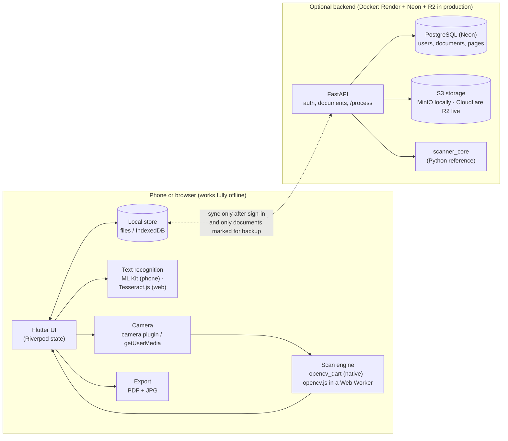
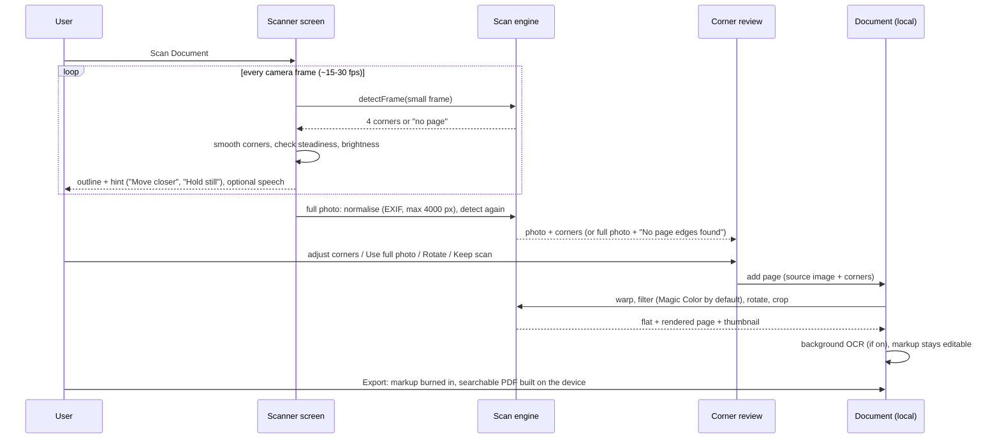

# Technical decisions

(For a component-by-component walkthrough of how the system works, see [`ARCHITECTURE.md`](ARCHITECTURE.md).)

Why DocScanner is built the way it is, what was considered instead, how a scan
flows through the system, what it cannot do, and questions to expect in a viva.

## 1. Architecture at a glance

Three implementations of the same detector exist on purpose:
`scanner_core` (Python, the reference), `opencv_dart` (phones and desktop tests) and
`scanner.js` (opencv.js, browsers). They share `shared/detector_params.json` and the
test photos in `shared/test_fixtures/`, and the tests check that they agree.

## 2. The scan flow

Detection, step by step (the "How it works" page on the website shows these images
for any photo you upload, using the real code):

1. Downscale to 500 px (pad 4 px so a page touching the border still closes).
2. Edge map: Gaussian blur 5×5, Canny with thresholds from the median brightness
   (0.67× / 1.33×), dilate 3×3 to close small gaps.
3. Candidates from the 12 largest outlines: the 4-point `approxPolyDP` quad, the
   quad from the 4 longest sides (a clipped corner), and the outline's extreme
   points (still right when a side bows); plus quads made of pairs of long
   straight edges taken from the simplified outlines and extended to meet, which
   recovers corners hidden by fingers or merged with clutter. (Not `HoughLinesP`:
   it is randomised and gave different lines in OpenCV 4 and 5.)
4. Each candidate must be convex, cover ≥ 4 % of the frame (an ID card at arm's
   length), have angles 35°–145° and follow its outline (a side may bow up to 12 %).
   Then it is **scored**: √area × border support × squareness × outline fit. Border
   support is the share of each side with a consistent brightness step from inside
   to outside; texture, stripes, other papers' insides and the photo frame have none.
   The best score wins, not the largest shape.
5. Passes, until one is confident (score ≥ 0.35), else the best of all: grayscale;
   CLAHE (white on white); lighting normalised by dividing by a heavily blurred copy
   + CLAHE (half shadows); colour saturation (a page on a coloured background).
6. Refine each straight side: strongest gradient across it, Huber line fit,
   intersect neighbours for sub-pixel corners (bowed outlines are not refined).
7. Flatten: trace the top and bottom edges from corner to corner; if one bows more
   than 1.5 % and the edge follows the curve clearly better than the straight side,
   a grid warp (perspective mapping + an offset blending the two curves) flattens
   the page; otherwise one perspective warp (bicubic).

Live preview: frames are taken only when the previous one is done (slow phones
drop frames), on a background isolate / Web Worker; auto-capture also waits for
a sharp frame (variance of the Laplacian ≥ 60 % of the recent best).

Filters: Magic Color divides by an estimated paper background (dilation to erase
the ink, then median and Gaussian blur, on a downscaled channel) to remove shadows,
then stretches contrast; Black & White does the same on gray and applies
adaptive (local) thresholding. On an ID card, B&W keeps the strip with the photo
and signature in grey (the short side with the most photo-like tones).

## 3. Decisions and alternatives

| Decision | Chosen | Alternatives considered | Why |
|---|---|---|---|
| App framework | **Flutter** | React Native, native Kotlin + Swift, PWA only | One codebase for Android, iPhone **and** web (the brief wanted the Mac webcam to work too); fast custom drawing for the live outline and markup; good accessibility support (semantics tree, text scaling). |
| Page detection | **Classic OpenCV** (edges + contours + line refinement) | ML segmentation (e.g. a DocAligner / U-Net model), ML Kit Document Scanner, Apple VisionKit | Runs on every platform including the browser, explainable step by step (good for a viva), no model download, about 20 ms per 720×1280 frame in opencv.js (measured by the JS speed test). ML Kit's scanner is Android-only and VisionKit iOS-only, and both hide the pipeline. An ML model would cope better with very cluttered backgrounds; see limitations. |
| OpenCV binding | **opencv_dart** on device, **opencv.js** in a Web Worker | Platform channels to native OpenCV; doing it in Dart pixel code | opencv_dart gives the same API on Android/iOS/macOS with no platform code. In the browser opencv.js runs in a worker so the UI never freezes. |
| Keeping 3 detectors in agreement | **Shared params + shared fixture photos + cross-checks** | One detector on a server | A server-only detector would break offline use and add latency. The Python reference is easier to experiment with; tests fail if the ports drift by more than a few pixels. |
| State management | **Riverpod 3** | Provider, Bloc, setState | Testable without widgets (scanner controller tests run against fake cameras), family providers per document, auto-dispose for camera resources. |
| Local storage | **Key-value store**: files on phones, IndexedDB on web | SQLite (drift), Hive, Isar | Documents are small JSON + image blobs; one tiny interface works on every platform including the web and in tests (memory store). |
| Offline-first, account optional | **Everything local; sign-in only adds backup** | Account required, cloud-first | The brief: every feature without signing in. Privacy: scans never leave the device unless the user opts in per document. |
| Sync conflicts | **Version number + "newer wins"**, conflicts reported to the user | CRDTs, three-way merge | A document is edited by one person at a time in practice; merging page lists is complex and error-prone. The user is told which documents were overwritten. |
| Backend | **FastAPI + PostgreSQL + MinIO** | Firebase, Supabase, Django | Typed request/response models and automatic `/docs`; S3-compatible storage keeps images out of the database; everything runs locally in Docker (no cloud account needed for a demo). |
| Passwords and sessions | **argon2 (pwdlib) + short JWT access tokens + refresh tokens** | Sessions in cookies, bcrypt | Stateless API for mobile clients; argon2 is the current recommendation. No secrets in the app: the server URL is the only setting. |
| Text recognition | **ML Kit** on phones, **Tesseract.js** on the web | Cloud OCR (Google Vision, Azure) | Offline and private. Word-level confidence filtering (≥ 50 %) plus a "meaningful text" check stop photos without text from producing random letters. Hindi: ML Kit Devanagari model / Tesseract `hin`. |
| Hidden corners, clutter | **Score candidate quads**; straight edges from outlines | Largest contour; Hough lines; skin-colour masks | The largest shape is often the busy background; scoring by border support picks the page. Skin colour was tried and dropped: wooden tables fall in the same colour range, so a skin mask erased the table edge around every page. |
| Curved pages | **Traced edge curves + grid warp** (classic OpenCV) | ML dewarping (DocTr, DewarpNet) | No model download; falls back to the plain warp when the edges are straight, so flat pages are untouched. |
| ID card mode | **Card shape (1.58:1) + OCR keywords + number patterns** | A trained card classifier | Works offline with the OCR already on the device; the rules are visible and testable. Card details stay on the device; cards are uploaded only after the user agrees. |
| PDF | **`pdf` package on the device**, invisible text layer | Server-side PDF | Works offline; the invisible OCR text (render mode 3) makes the PDF searchable and copyable; Noto Sans Devanagari is embedded for Hindi. |
| Markup | **Vector items stored per page**, painted live, **burned in at export** | Draw straight into the image | Items stay editable (move, resize, undo) and survive rotate/crop (they are transformed with the page); export produces a normal image/PDF any viewer shows. |
| Photo orientation | **Normalise once at entry** (apply EXIF, cap 4000 px, re-encode) | Handle EXIF everywhere | Fixed a real bug: corners were computed on rotated pixels in some browsers. One upright image means corner coordinates mean the same thing everywhere. |
| Speech guidance | **flutter_tts** (system voices; browser speechSynthesis) | Recorded audio | Works in English and Hindi with the device's voices, nothing to ship; off by default, one switch in Settings. |
| Web accessibility | **Semantics tree on at start-up** | Flutter's default (hidden "Enable accessibility" button) | Screen readers and keyboard users get a working page immediately; the cost is a little extra DOM. |

## 4. Accessibility approach (WCAG 2.2 AA)

- Every action is an icon **plus a text label**; no icon-only buttons or hidden menus.
- Targets ≥ 48×48 dp (Android) / 44×44 pt (iOS), visible 3 px focus outline.
- Contrast ≥ 4.5:1 in light, dark and high-contrast themes; selection is never shown
  by colour alone (check marks, "Selected", Before/After labels).
- Text size up to 200 % without overflow (layouts wrap; toolbars grow).
- Screen readers: labels, live regions for hints and progress, captures announced
  ("Captured, page 2"), custom actions to move corners, an item list in markup.
- Keyboard: Tab order, Enter/Space, arrow keys for corners and markup, Ctrl/Cmd+Z.
- Reduced motion respected; spoken and haptic guidance optional.
- Checked by Flutter guideline tests on every screen and by axe-core + Lighthouse
  (`tools/audit`).

## 5. Limitations

- Classic detection struggles when the page and background have almost the same
  colour **and** texture, or when the page is heavily folded or curled (it assumes
  four straight edges). The user can always drag the corners or keep the full photo.
- No page dewarping for curved book pages.
- Printed text only; handwriting recognition is poor. Tesseract on the web is
  slower than ML Kit (about 1-3 s per page).
- Sync keeps the newer version when the same document is edited on two devices.
- Browser camera needs https (or localhost); flashlight control depends on the
  browser and phone; vibration does not exist on desktop browsers.
- Phone-specific behaviour (camera focus, flash, ML Kit, TalkBack/VoiceOver, share
  sheet) is covered by manual checks, not automated tests (`docs/TESTING.md`).

## 6. Viva questions and answers

**Why not use a machine-learning model to find the page?**
Classic OpenCV runs everywhere (including the browser) in about 20 ms per frame, needs no
model download, and every step can be shown and explained. It fails on hard
backgrounds; for those the user corrects the corners. An ML segmenter would be the
next step if the target users mostly scan on cluttered desks.

**How does auto-capture decide when to take the photo?**
The detected corners are smoothed over frames; when they move less than a small
threshold for a number of consecutive frames (the ring on the shutter fills), and the
page covers enough of the view, it captures. After a capture it waits until the page
leaves or clearly moves, so one sheet is not captured twice.

**Why detect again on the full photo?**
Live frames are small (≤ 640 px) and slightly blurred by motion. The still photo is
sharper and larger; detecting on it gives more accurate corners. If it fails, the
preview's outline is reused, and if both fail the user sees "No page edges found".

**What does the perspective transform do mathematically?**
It solves for the 3×3 homography H mapping the four detected corners to the corners of
a rectangle (8 unknowns, 4 point pairs × 2 equations), then samples every output pixel
from the inverse-mapped input position with bicubic interpolation.

**How do you know the three detector implementations behave the same?**
They read the same parameters file, and the Dart, JavaScript and Python tests run on
the same fixture photos with expected corners; the JS and Dart tests also compare
against the Python reference output within a few pixels.

**How is the app usable without an account, and what does signing in change?**
All documents, images and settings live on the device. Signing in adds backup and
sync to the FastAPI server; the user chooses whether to upload documents that already
exist. Nothing is uploaded without that choice.

**How are sync conflicts handled?**
Each document has a version. The client sends the version it edited; if the server
has a newer one it answers 409 and the newer edit wins. The user is told which
documents were affected.

**How did you make OCR stop producing random letters on photos without text?**
Words below 50 % confidence are dropped, and a line is kept only if it looks like
words (enough letters or digits, not just symbols). The app then says "No text found
on this page" instead of showing noise.

**Why is markup kept as separate items rather than drawn into the image?**
So it can be moved, resized, recoloured, deleted and undone at any time, and follow
the page through rotation and cropping. It is flattened into the pixels only when
exporting, so any PDF or image viewer shows it.

**What would you improve with more time?**
An ML page segmenter for difficult backgrounds, curved-page dewarping, real-device
test runs on a device farm, end-to-end encryption of backups, and field-level merging
for sync conflicts.

**How did you test accessibility?**
Automated: Flutter's guideline matchers (tap targets, labels, contrast) on every
screen in light, dark and high-contrast themes, 200 % text without overflow, keyboard
order; axe-core and Lighthouse on the web build. Manual: TalkBack/VoiceOver on a phone
(listed in `docs/TESTING.md`).
